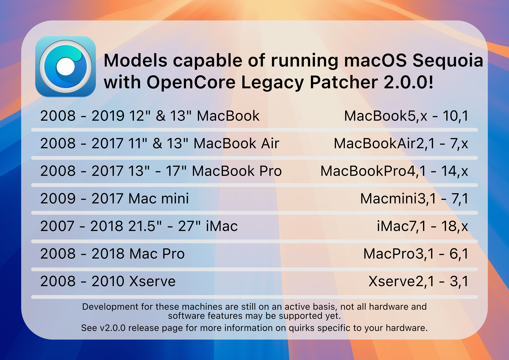

# macOS Sequoia


Another year, another release.

This time Apple dropped surprisingly few amount of Macs. With the release of OpenCore Legacy Patcher 2.0.0, early support for macOS Sequoia has been implemented.


## Newly dropped hardware

* MacBookAir8,1 :       MacBook Air (2018)
* MacBookAir8,2 :       MacBook Air (2019)

## Current status

OpenCore Legacy Patcher 2.0.0 supports Sequoia for the models below, however some challenges remain. You can find information about them further down this page.



The T2-related AppleKeyStore panic that used to keep the recently dropped MacBookAir8,x models (and other unsupported T2 Macs) from booting through OpenCorePkg has been resolved in OpenCore Legacy Patcher T2. T2 support is still in alpha, though: installation does not complete yet. See [T2 security chip](#t2-security-chip) below for the current status.

## Non-functional features

On majority of patched Macs, iPhone Mirroring and Apple Intelligence won't be functional.

iPhone Mirroring requires T2 for attestation and Apple Intelligence requires an NPU only found in Apple Silicon, the patcher is unable to provide a fix for these as they're hardware requirements.

## Issues

* [Dual socket CPUs with Mac Pros and Xserve](#dual-socket-cpus-with-mac-pro-2008-and-xserve-2008)
* [T2 Security chip](#t2-security-chip)
* [USB 1.1 (OHCI/UHCI) Support](#usb-1-1-ohci-uhci-support)
* [Graphics support and issues](#graphics-support-and-issues)


### Dual socket CPUs with Mac Pro 2008 and Xserve 2008

Booting Sequoia on Mac Pro 2008 (MacPro3,1) or Xserve 2008 (Xserve2,1) with more than 4 cores will cause Sequoia to panic. OpenCore Legacy Patcher T2 will automatically disable additional cores.

This is due to the dual socket nature of the machine, and likely some firmware/ACPI table incompatibility. 

**If building OpenCore for older OS, this limitation can be disabled in Settings -> Build -> "MacPro3,1/Xserve2,1 Workaround".** 

::: warning Note

Dual booting Sequoia and older will not be possible with all cores enabled due to reasons described before. In these cases you will be limited to 4 cores.

:::

### T2 security chip

Booting T2 Macs such as the MacBookAir8,x (2018/19) series through OpenCorePkg used to end in a kernel panic, because AppleKeyStore.kext ran into timeouts while communicating with the T2 chip:

```
"AppleKeyStore":3212:0: sks timeout strike 18
"AppleKeyStore":3212:0: sks timeout strike 19
"AppleKeyStore":3212:0: sks timeout strike 20
panic(cpu 0 caller 0xffffff801cd12509): "AppleSEPManager panic for "AppleKeyStore": sks request timeout" @AppleSEPManagerIntel.cpp:809
```

**This panic no longer occurs.** OpenCore Legacy Patcher T2 now gets past the AppleKeyStore timeouts on unsupported T2 Macs, so the machines boot into the installer.

However, T2 support is still in **alpha**. The remaining issue is that the macOS installation currently ends with "Failed to install a software update" before it finishes. We cannot provide an estimate on when T2 installations will fully work yet.

If you want to help test or share results, please use [GitHub Discussions](https://github.com/albert-mueller/OpenCore-Legacy-Patcher-T2/discussions).

### USB 1.1 (OHCI/UHCI) Support

For Penryn systems, pre-2013 Mac Pros and Xserve, USB 1.1 support was outright removed in macOS Ventura, therefore this applies all the way to Sequoia.
While USB 1.1 may seem unimportant, it handles many important devices on your system. These include:

* Keyboard and Trackpad for laptops
* IR Receivers
* Bluetooth

Refer to [the troubleshooting page](TROUBLESHOOT-HARDWARE.md#keyboard-mouse-and-trackpad-not-working-in-installer-or-after-update) on how to workaround this issue.


### Graphics support and issues
This build includes both Legacy Metal and non-Metal patches for macOS Sequoia. Refer to the following links for more information about Legacy Metal and non-Metal support and their respective issues.

* [Legacy Metal](https://github.com/dortania/OpenCore-Legacy-Patcher/issues/1008)
* [Non-Metal](https://github.com/dortania/OpenCore-Legacy-Patcher/issues/108)
